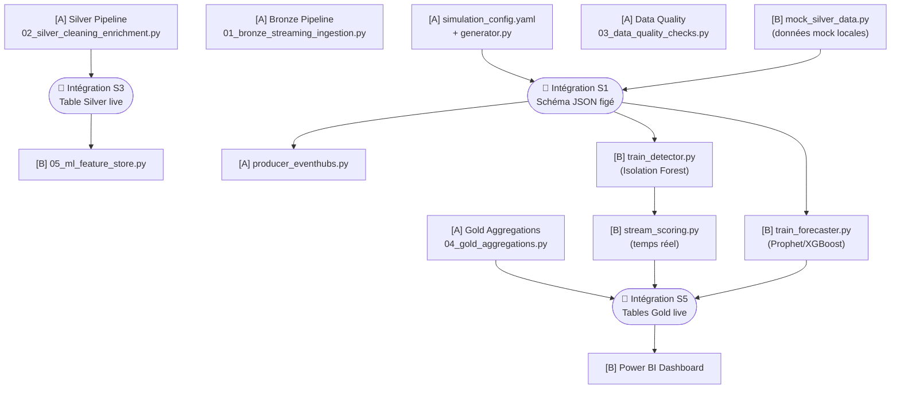

# 👥 TEAM_WORK_DISTRIBUTION.md
# EnergyData Lakehouse Platform — Répartition Équipe 2 Développeurs

> **Projet** : Real-Time Energy Data Lakehouse & Predictive Analytics Platform  
> **Équipe** : 2 étudiants · Développement parallèle  
> **Stratégie** : Séparation par domaine technique vertical, non par découpage linéaire des sprints  
> **Créé le** : 31 octobre 2026

---

## 🧠 Principe Directeur de la Répartition

> ⚠️ **Pourquoi ne pas diviser par sprints (1-4 / 5-8) ?**
>
> Une division linéaire créerait un **goulot d'étranglement** : le second développeur resterait bloqué jusqu'à ce que le premier ait terminé les 4 premiers sprints. Ce n'est pas du développement parallèle — c'est de la séquentialité déguisée.

La stratégie retenue est une **séparation par domaine technique vertical** :

```
┌─────────────────────────────────────────────────────────────────────┐
│                    EnergyData Lakehouse Platform                     │
├──────────────────────────────┬──────────────────────────────────────┤
│       MEMBRE A               │              MEMBRE B                │
│  🏗️ Data Platform Engineer   │      🤖 ML & Analytics Engineer      │
├──────────────────────────────┼──────────────────────────────────────┤
│  • Simulation IoT            │  • ML Feature Engineering            │
│  • Azure Event Hubs          │  • Anomaly Detection                 │
│  • Pipeline Bronze/Silver    │  • Load Forecasting                  │
│  • Data Quality              │  • MLflow & Model Registry           │
│  • Gold Aggregations         │  • Power BI Dashboard                │
│  • Infrastructure (Terraform)│  • CI/CD & Documentation             │
│  • Tests Data Pipeline       │  • Tests ML                          │
└──────────────────────────────┴──────────────────────────────────────┘
                               │
              ┌────────────────┴─────────────────┐
              │    🔗 CONTRAT D'INTERFACE         │
              │    Tables Delta Gold (schéma      │
              │    figé dès J+3)                  │
              │    + simulation_config.yaml        │
              └───────────────────────────────────┘
```

Les deux membres peuvent démarrer **le jour 1** car leurs responsabilités sont découplées dès le départ par un contrat d'interface clair.

---

## 📊 Tableau Comparatif Membre A / Membre B

| Dimension | 🏗️ Membre A — Data Platform | 🤖 Membre B — ML & Analytics |
|:----------|:---------------------------|:------------------------------|
| **Rôle** | Data Platform Engineer | ML & Analytics Engineer |
| **Domaine principal** | Ingestion, pipeline, stockage | Intelligence, visualisation, publication |
| **Sprints couverts** | 1 (partiel), 2, 3, 4, 5 (partiel), 8 (partiel) | 1 (partiel), 5 (partiel), 6, 7, 8 (partiel) |
| **Technos principales** | Azure Event Hubs, Spark Streaming, Delta Lake, Great Expectations | scikit-learn, Prophet, XGBoost, MLflow, Power BI, DAX |
| **Dossiers propriétaires** | `data_simulation/`, `databricks/` (00→04), `config/`, `infra/` | `ml_engine/`, `powerbi/`, `databricks/` (05) |
| **Fichiers partagés** | `.env.example`, `requirements.txt`, `tests/` | `.env.example`, `requirements.txt`, `tests/` |
| **Fichiers en lecture seule** | Schémas Gold (définis par contrat) | Schémas Silver/Gold (produits par A) |
| **Output principal** | Tables Delta Bronze, Silver, Gold peuplées | Modèles ML entraînés + Dashboard Power BI |
| **Prérequis Azure** | Event Hubs, ADLS Gen2, Databricks | Databricks (SQL Warehouse), MLflow |
| **Complexité technique** | Haute (streaming temps réel, watermarking) | Haute (ML time series, DirectQuery BI) |
| **Charge estimée** | ~60 % effort total | ~40 % effort total (+ documentation) |

> [!NOTE]
> La légère asymétrie (60/40) est intentionnelle et compensée : Membre B porte la charge du **rapport PFE et du README**, qui représentent un effort non négligeable.

---

## 🗂️ Répartition Précise des Fichiers et Dossiers

### 🏗️ Membre A — Propriétaire exclusif

```
EnergyData/
├── config/
│   ├── simulation_config.yaml        ← MEMBRE A (crée)
│   └── databricks_config.json        ← MEMBRE A (crée)
├── data_simulation/
│   ├── __init__.py                   ← MEMBRE A (crée)
│   ├── generator.py                  ← MEMBRE A (crée)
│   ├── anomaly_injector.py           ← MEMBRE A (crée)
│   ├── producer_eventhubs.py         ← MEMBRE A (crée)
│   └── weather_enricher.py           ← MEMBRE A (crée)
├── databricks/
│   ├── 00_setup_mounts.py            ← MEMBRE A (crée)
│   ├── 01_bronze_streaming_ingestion.py  ← MEMBRE A (crée)
│   ├── 02_silver_cleaning_enrichment.py  ← MEMBRE A (crée)
│   ├── 03_data_quality_checks.py     ← MEMBRE A (crée)
│   └── 04_gold_aggregations.py       ← MEMBRE A (crée)
├── infra/
│   └── terraform/
│       ├── main.tf                   ← MEMBRE A (crée)
│       └── variables.tf              ← MEMBRE A (crée)
├── tests/
│   └── test_generator.py             ← MEMBRE A (crée)
└── .github/
    └── workflows/
        └── deploy-databricks.yml     ← MEMBRE A (crée)
```

### 🤖 Membre B — Propriétaire exclusif

```
EnergyData/
├── databricks/
│   └── 05_ml_feature_store.py        ← MEMBRE B (crée)
├── ml_engine/
│   ├── __init__.py                   ← MEMBRE B (crée)
│   ├── anomaly_detection/
│   │   ├── train_detector.py         ← MEMBRE B (crée)
│   │   └── stream_scoring.py         ← MEMBRE B (crée)
│   ├── forecasting/
│   │   ├── train_forecaster.py       ← MEMBRE B (crée)
│   │   └── evaluate_mlflow.py        ← MEMBRE B (crée)
│   └── model_registry/
│       ├── promote_model.py          ← MEMBRE B (crée)
│       └── rollback_model.py         ← MEMBRE B (crée)
├── powerbi/
│   ├── templates/                    ← MEMBRE B (crée)
│   └── dax_measures.md               ← MEMBRE B (crée)
├── tests/
│   └── test_spark_transformations.py ← MEMBRE B (crée)
└── .github/
    └── workflows/
        └── ci-pipeline.yml           ← MEMBRE B (crée)
```

### 🤝 Fichiers partagés (modification par les deux — via PR uniquement)

```
EnergyData/
├── .env.example      ← Toute nouvelle variable → PR + review de l'autre
├── requirements.txt  ← Toute nouvelle dépendance → PR + review de l'autre
├── README.md         ← MEMBRE B rédige, MEMBRE A valide les sections technique
└── IMPLEMENTATION_PLAN.md  ← Référence immuable, aucune modification
```

---

## 🔗 Contrats d'Interface — Ce qui Lie les Deux Parties

> [!IMPORTANT]
> Ces contrats doivent être **figés lors du kick-off (J+3)** et ne peuvent être modifiés qu'avec l'accord des deux membres. Ils permettent à Membre B de coder sans attendre que A ait fini.

### Contrat 1 — Schéma du Payload IoT (JSON Event Hubs)

Figé dans `IMPLEMENTATION_PLAN.md §3`. Membre B utilise ce schéma pour construire ses features **sans attendre le simulateur réel**.

```json
{
  "device_id": "STRING",
  "timestamp": "ISO8601",
  "substation_id": "STRING",
  "location": { "latitude": "DOUBLE", "longitude": "DOUBLE", "zone": "STRING" },
  "metrics": {
    "voltage_v": "DOUBLE",
    "current_a": "DOUBLE",
    "active_power_kw": "DOUBLE",
    "reactive_power_kvar": "DOUBLE",
    "power_factor": "DOUBLE",
    "frequency_hz": "DOUBLE",
    "ambient_temp_c": "DOUBLE"
  },
  "status_flag": "STRING"
}
```

### Contrat 2 — Schéma de la Table Silver Delta

Membre B lit la table Silver pour entraîner ses modèles. Ce schéma est immuable.

| Colonne | Type | Propriétaire |
|:--------|:-----|:-------------|
| `device_id` | STRING | Membre A produit |
| `substation_id` | STRING | Membre A produit |
| `zone` | STRING | Membre A produit |
| `event_time` | TIMESTAMP | Membre A produit |
| `voltage_v` | DOUBLE | Membre A produit |
| `current_a` | DOUBLE | Membre A produit |
| `active_power_kw` | DOUBLE | Membre A produit |
| `power_factor` | DOUBLE | Membre A produit |
| `frequency_hz` | DOUBLE | Membre A produit |
| `ambient_temp_c` | DOUBLE | Membre A produit |
| `is_valid_reading` | BOOLEAN | Membre A produit |
| `is_duplicate` | BOOLEAN | Membre A produit |
| `ingestion_latency_sec` | DOUBLE | Membre A produit |

### Contrat 3 — Schéma des Tables Gold (Partagé)

Ces tables sont **produites par A** (agrégations) et **complétées par B** (scores ML, forecasts).

**`gold_energy_5min_aggregates`** — Membre A écrit, Membre B lit en lecture seule
| Colonne | Type |
|:--------|:-----|
| `substation_id` | STRING |
| `zone` | STRING |
| `window_start` | TIMESTAMP |
| `window_end` | TIMESTAMP |
| `avg_active_power_kw` | DOUBLE |
| `peak_active_power_kw` | DOUBLE |
| `total_energy_kwh` | DOUBLE |
| `avg_power_factor` | DOUBLE |
| `voltage_min` | DOUBLE |
| `voltage_max` | DOUBLE |

**`gold_detected_anomalies`** — Membre A crée la table (vide), Membre B écrit les lignes
| Colonne | Type |
|:--------|:-----|
| `anomaly_id` | STRING (UUID) |
| `device_id` | STRING |
| `timestamp` | TIMESTAMP |
| `anomaly_type` | STRING |
| `severity` | STRING (`Low`/`Medium`/`Critical`) |
| `z_score` | DOUBLE |

**`gold_load_forecasts`** — Membre A crée la table (vide), Membre B écrit les lignes
| Colonne | Type |
|:--------|:-----|
| `forecast_id` | STRING (UUID) |
| `substation_id` | STRING |
| `target_timestamp` | TIMESTAMP |
| `predicted_active_power_kw` | DOUBLE |
| `lower_bound_kw` | DOUBLE |
| `upper_bound_kw` | DOUBLE |
| `model_version` | STRING |

### Contrat 4 — Données Mock pour Membre B (Développement Offline)

Membre B ne doit **pas attendre** que Membre A ait fini son pipeline. Il utilise des données mock générées localement :

```python
# À placer dans tests/fixtures/mock_silver_data.py
# Membre B génère lui-même 30 jours de données synthétiques
# en respectant strictement le schéma Silver — Contrat 2
```

---

## 🌿 Stratégie GitHub — Collaboration Simultanée

### Structure des branches

```
main                          ← Branche protégée, production uniquement
├── develop                   ← Branche d'intégration commune
│   ├── feature/memberA-simulator      ← Sprint 1 — Membre A
│   ├── feature/memberA-eventhubs      ← Sprint 2 — Membre A
│   ├── feature/memberA-bronze-silver  ← Sprint 3 — Membre A
│   ├── feature/memberA-dataquality    ← Sprint 4 — Membre A
│   ├── feature/memberA-gold           ← Sprint 5 — Membre A
│   ├── feature/memberB-feature-store  ← Sprint 5 — Membre B
│   ├── feature/memberB-anomaly-ml     ← Sprint 6a — Membre B
│   ├── feature/memberB-forecasting    ← Sprint 6b — Membre B
│   ├── feature/memberB-powerbi        ← Sprint 7 — Membre B
│   └── feature/memberB-cicd-docs      ← Sprint 8 — Membre B
└── hotfix/                   ← Correctifs urgents uniquement
```

### Règles de collaboration Git

```
✅ À TOUJOURS FAIRE :
  - Travailler sur sa branche feature/ dédiée
  - Pull Request vers develop (jamais directement vers main)
  - 1 review obligatoire de l'autre membre avant merge
  - Commits atomiques avec préfixe : [A] ou [B] + type (feat/fix/docs/test)
  - Pull develop avant de créer une nouvelle branche

❌ À NE JAMAIS FAIRE :
  - Push direct sur develop ou main
  - Modifier un fichier propriété de l'autre sans PR
  - Modifier les contrats d'interface sans accord mutuel
  - Merger sans review
```

### Format des commits

```bash
# Membre A
git commit -m "[A] feat: add IoT event generator with Gaussian noise"
git commit -m "[A] fix: correct watermark duration in silver pipeline"
git commit -m "[A] test: add voltage range validation unit tests"

# Membre B
git commit -m "[B] feat: train Isolation Forest anomaly detector"
git commit -m "[B] fix: correct MLflow experiment naming"
git commit -m "[B] docs: add DAX measures documentation"
```

### Protection de la branche `main`

Configurer dans les Settings GitHub du repo :
- ✅ Require pull request reviews (minimum 1)
- ✅ Require status checks to pass (CI pipeline)
- ✅ Restrict pushes (membres uniquement)
- ✅ Require branches to be up to date before merge

---

## 📅 Planning Détaillé — Développement Parallèle

> **Durée totale estimée** : 6 semaines · **Démarrage** : Semaine 1

### Semaine 1 — Fondations & Kick-off (Sprint 1 parallèle)

```
┌─────────────────────────────────────────────────────────────────────┐
│ JOUR 1-2 (J+1, J+2) — COMMUN AUX DEUX MEMBRES                      │
│                                                                     │
│ ✅ Initialiser le dépôt GitHub commun                               │
│ ✅ Configurer les branches (main, develop)                          │
│ ✅ Figer les Contrats d'Interface (schémas JSON + Delta)            │
│ ✅ Chacun clone le repo et crée son venv Python                     │
│ ✅ Session de synchronisation : qui fait quoi, quand, comment       │
└─────────────────────────────────────────────────────────────────────┘
```

| Jour | 🏗️ Membre A | 🤖 Membre B |
|:----:|:-----------|:-----------|
| J+3 | `config/simulation_config.yaml` | `tests/fixtures/mock_silver_data.py` (données mock) |
| J+4 | `data_simulation/__init__.py` + `generator.py` (base) | Design de l'architecture ML (`ml_engine/__init__.py`) |
| J+5 | `generator.py` (finalisation) + `anomaly_injector.py` | `databricks/05_ml_feature_store.py` (design + structure) |
| J+6 | `weather_enricher.py` | Feature engineering local sur données mock |
| J+7 | `tests/test_generator.py` + PR vers develop | PR `feature/memberB-feature-store` vers develop |

**🔗 Point d'intégration S1** : Merge `feature/memberA-simulator` → `develop`  
Membre B récupère le simulateur réel et peut remplacer ses données mock.

---

### Semaine 2 — Ingestion & ML Feature Engineering (Sprints 2 & 5B)

| Jour | 🏗️ Membre A | 🤖 Membre B |
|:----:|:-----------|:-----------|
| J+8 | Provisionner Azure Event Hubs (portail) | `ml_engine/anomaly_detection/train_detector.py` (Isolation Forest) |
| J+9 | `data_simulation/producer_eventhubs.py` | Entraînement local sur données mock + tuning hyperparamètres |
| J+10 | Tests d'envoi + validation portail Azure | `ml_engine/anomaly_detection/stream_scoring.py` (Pandas UDF) |
| J+11 | Test montée en charge 500 msg/sec | `ml_engine/forecasting/train_forecaster.py` (Prophet) |
| J+12 | PR `feature/memberA-eventhubs` + doc | `ml_engine/forecasting/evaluate_mlflow.py` (métriques MLflow) |

---

### Semaine 3 — Pipeline Databricks & Modèles ML (Sprint 3 & 6A)

| Jour | 🏗️ Membre A | 🤖 Membre B |
|:----:|:-----------|:-----------|
| J+15 | Provisionner Databricks + ADLS Gen2 | XGBoost forecaster + comparaison Prophet vs XGBoost |
| J+16 | `databricks/00_setup_mounts.py` | `ml_engine/forecasting/evaluate_mlflow.py` (finalisation) |
| J+17 | `databricks/01_bronze_streaming_ingestion.py` | MLflow Registry : scripts Staging → Production |
| J+18 | `databricks/02_silver_cleaning_enrichment.py` | Tests unitaires ML (`tests/test_spark_transformations.py` partie ML) |
| J+19 | Validation schéma Silver en streaming | PR `feature/memberB-anomaly-ml` + `feature/memberB-forecasting` |

**🔗 Point d'intégration S3** : Merge des deux branches → `develop`  
Membre B peut maintenant lire la vraie table Silver Databricks.

---

### Semaine 4 — Data Quality & Scoring Temps Réel (Sprints 4 & 6B)

| Jour | 🏗️ Membre A | 🤖 Membre B |
|:----:|:-----------|:-----------|
| J+22 | `databricks/03_data_quality_checks.py` (règles physiques) | Intégration du modèle Staging sur vraie table Silver |
| J+23 | Dead Letter Queue (table quarantaine Delta) | Scoring temps réel sur flux Silver → `gold_detected_anomalies` |
| J+24 | Great Expectations assertions + SLAs | Forecasting sur historique Gold → `gold_load_forecasts` |
| J+25 | PR `feature/memberA-dataquality` + tests | Validation des prédictions (MAPE < 10 %) |
| J+26 | Revue croisée + corrections | PR `feature/memberB-scoring-realtime` vers develop |

---

### Semaine 5 — Couche Gold & Power BI (Sprint 5 & 7)

| Jour | 🏗️ Membre A | 🤖 Membre B |
|:----:|:-----------|:-----------|
| J+29 | `databricks/04_gold_aggregations.py` (fenêtres 5min/1h) | Configurer Databricks SQL Warehouse |
| J+30 | Tables Gold peuplées + Z-ORDER | Connexion Power BI Desktop en DirectQuery |
| J+31 | `config/databricks_config.json` (finalisation) | Page 1 Power BI : Opérations Temps Réel |
| J+32 | `infra/terraform/main.tf` + `variables.tf` | Page 2 Power BI : Analyse Historique |
| J+33 | PR `feature/memberA-gold` + tests Spark | Page 3 Power BI : Prédictions + `powerbi/dax_measures.md` |

**🔗 Point d'intégration S5** : Merge complet → `develop`  
Toutes les tables Gold sont disponibles — Power BI peut se connecter en DirectQuery réel.

---

### Semaine 6 — Industrialisation & Rapport PFE (Sprint 8)

| Jour | 🏗️ Membre A | 🤖 Membre B |
|:----:|:-----------|:-----------|
| J+36 | `.github/workflows/deploy-databricks.yml` | `.github/workflows/ci-pipeline.yml` (ruff, black, pytest) |
| J+37 | Tests d'intégration bout-en-bout | Rédaction `README.md` (architecture, badges, captures) |
| J+38 | Revue croisée : vérification des pipelines | Rédaction rapport PFE (chapitres Data Engineering) |
| J+39 | Corrections + optimisations finales | Rapport PFE (chapitres ML + résultats) |
| J+40 | **Merge final `develop → main`** | **Préparation soutenance PFE** |

---

## 🔄 Dépendances Entre les Deux Parties



### Matrice des dépendances critiques

| Livrable Membre B | Dépend de Membre A | Date de disponibilité |
|:------------------|:-------------------|:----------------------|
| Feature store (local) | Contrat schéma Silver (figé J+3) | J+3 — Immédiat |
| Train Isolation Forest | Données mock (autogénérées par B) | J+3 — Immédiat |
| Scoring Silver réel | Table Silver peuplée (Sprint 3) | J+19 |
| Forecasting Gold réel | Table Gold peuplée (Sprint 5) | J+33 |
| Power BI DirectQuery | SQL Warehouse + Tables Gold | J+33 |

> [!TIP]
> Membre B peut avancer à 70 % de son travail ML **avant** que Membre A ait fini le pipeline, grâce aux données mock conformes au contrat d'interface.

---

## ✅ Checklists Individuelles

### 🏗️ Checklist Membre A — Data Platform Engineer

#### Sprint 1 — Simulateur IoT
- [ ] Créer environnement virtuel Python + `pip install -r requirements.txt`
- [ ] `config/simulation_config.yaml` — paramètres capteurs
- [ ] `data_simulation/__init__.py` — module Python
- [ ] `data_simulation/generator.py` — séries temporelles réalistes
- [ ] `data_simulation/anomaly_injector.py` — injection de pannes
- [ ] `data_simulation/weather_enricher.py` — API Open-Meteo
- [ ] `tests/test_generator.py` — tests unitaires (100 % pass)
- [ ] PR `feature/memberA-simulator` → develop + review de B

#### Sprint 2 — Azure Event Hubs
- [ ] Provisionner Azure Event Hubs Standard (portail)
- [ ] `data_simulation/producer_eventhubs.py` — client AMQP
- [ ] Test bout-en-bout (10 événements → portail Azure)
- [ ] Test montée en charge (≥ 500 msg/sec)
- [ ] PR `feature/memberA-eventhubs` → develop + review de B

#### Sprint 3 — Bronze & Silver
- [ ] Provisionner Databricks Workspace + ADLS Gen2
- [ ] `config/databricks_config.json`
- [ ] `databricks/00_setup_mounts.py` — montage ADLS + Key Vault
- [ ] `databricks/01_bronze_streaming_ingestion.py` — streaming + checkpointing
- [ ] `databricks/02_silver_cleaning_enrichment.py` — parsing + watermark + dédup
- [ ] Validation schéma Silver (latence < 30s)
- [ ] PR `feature/memberA-bronze-silver` → develop + review de B

#### Sprint 4 — Data Quality
- [ ] `databricks/03_data_quality_checks.py` — règles physiques
- [ ] Table Delta `quarantine_invalid_events`
- [ ] Great Expectations assertions
- [ ] SLAs documentés (taux de validité ≥ 98 %)
- [ ] PR `feature/memberA-dataquality` → develop + review de B

#### Sprint 5 — Couche Gold
- [ ] `databricks/04_gold_aggregations.py` — fenêtres 5min/1h
- [ ] Table `gold_energy_5min_aggregates` opérationnelle
- [ ] Tables `gold_detected_anomalies` et `gold_load_forecasts` (vides, prêtes pour B)
- [ ] OPTIMIZE + ZORDER sur colonnes clés
- [ ] PR `feature/memberA-gold` → develop + review de B

#### Sprint 8 (partiel) — Infra & CI/CD Deploy
- [ ] `infra/terraform/main.tf` + `variables.tf`
- [ ] `.github/workflows/deploy-databricks.yml`
- [ ] Tests d'intégration bout-en-bout validés
- [ ] PR finale + review de B

---

### 🤖 Checklist Membre B — ML & Analytics Engineer

#### Sprint 1 (partiel) — Setup & Mock Data
- [ ] Créer environnement virtuel Python + `pip install -r requirements.txt`
- [ ] `tests/fixtures/mock_silver_data.py` — 30 jours de données mock conformes au schéma Silver
- [ ] `ml_engine/__init__.py`
- [ ] Design de l'architecture ML (README du dossier)

#### Sprint 5 (partiel) — Feature Store
- [ ] `databricks/05_ml_feature_store.py` — extraction features rolling stats
- [ ] Encodage temporel (heure, jour, saison)
- [ ] Features météo intégrées
- [ ] PR `feature/memberB-feature-store` → develop + review de A

#### Sprint 6A — Anomaly Detection
- [ ] `ml_engine/anomaly_detection/train_detector.py` — Isolation Forest
- [ ] Entraînement sur données mock → baseline
- [ ] Entraînement sur données Silver réelles (post J+19)
- [ ] `ml_engine/anomaly_detection/stream_scoring.py` — Pandas UDF Spark
- [ ] Seuils de sévérité Low/Medium/Critical calibrés
- [ ] PR `feature/memberB-anomaly-ml` → develop + review de A

#### Sprint 6B — Load Forecasting
- [ ] `ml_engine/forecasting/train_forecaster.py` — Prophet
- [ ] `ml_engine/forecasting/train_forecaster.py` — XGBoost (comparaison)
- [ ] `ml_engine/forecasting/evaluate_mlflow.py` — métriques RMSE/MAE/MAPE
- [ ] Validation : MAPE < 10 % sur données de test
- [ ] Intervalles de confiance (lower/upper bound)
- [ ] PR `feature/memberB-forecasting` → develop + review de A

#### Sprint 6C — MLOps & Model Registry
- [ ] `ml_engine/model_registry/promote_model.py` — Staging → Production
- [ ] `ml_engine/model_registry/rollback_model.py` — rollback automatique
- [ ] `tests/test_spark_transformations.py` — tests UDF de scoring
- [ ] PR MLflow Registry → develop + review de A

#### Sprint 7 — Power BI Dashboard
- [ ] Configurer Databricks SQL Warehouse
- [ ] Connexion Power BI Desktop DirectQuery
- [ ] Page 1 : Opérations Temps Réel (carte, KPI, courbe live)
- [ ] Page 2 : Analyse Historique (tendances, anomalies, heatmap)
- [ ] Page 3 : Prédictions (courbe H+24/J+7 + intervalles)
- [ ] `powerbi/dax_measures.md` — mesures DAX documentées
- [ ] `powerbi/templates/` — fichier `.pbit` ou documentation modèle
- [ ] Performance DirectQuery < 5s
- [ ] PR `feature/memberB-powerbi` → develop + review de A

#### Sprint 8 (partiel) — CI/CD, README & Rapport PFE
- [ ] `.github/workflows/ci-pipeline.yml` — ruff, black, pytest
- [ ] `README.md` complet (architecture diagram, badges, captures)
- [ ] Rapport PFE — chapitre Architecture
- [ ] Rapport PFE — chapitre Data Engineering
- [ ] Rapport PFE — chapitre MLOps & Résultats
- [ ] PR finale + review de A

---

## 🔀 Stratégie d'Intégration Finale

### Les 3 Points d'Intégration Majeurs

```
POINT D'INTÉGRATION 1 — Semaine 1, J+7
━━━━━━━━━━━━━━━━━━━━━━━━━━━━━━━━━━━━━━
Action : Merge feature/memberA-simulator → develop
Qui merge : Membre A (review par Membre B)
Ce que B fait après : Remplace mock_silver_data.py par appels au vrai générateur
Risque : Faible (schéma figé au contrat)
━━━━━━━━━━━━━━━━━━━━━━━━━━━━━━━━━━━━━━

POINT D'INTÉGRATION 2 — Semaine 3, J+19
━━━━━━━━━━━━━━━━━━━━━━━━━━━━━━━━━━━━━━
Action : Merge feature/memberA-bronze-silver → develop
Qui merge : Membre A (review par Membre B)
Ce que B fait après : Connecte ses modèles ML à la vraie table Silver Databricks
Risque : Moyen — vérifier que le schéma Silver correspond exactement au contrat
━━━━━━━━━━━━━━━━━━━━━━━━━━━━━━━━━━━━━━

POINT D'INTÉGRATION 3 — Semaine 5, J+33
━━━━━━━━━━━━━━━━━━━━━━━━━━━━━━━━━━━━━━
Action : Merge toutes les branches → develop → main
Qui merge : Les deux membres ensemble (session live)
Ce que B fait après : Connecte Power BI aux tables Gold réelles en DirectQuery
Risque : Élevé — session de merge live recommandée avec les deux membres présents
━━━━━━━━━━━━━━━━━━━━━━━━━━━━━━━━━━━━━━
```

### Protocole de Merge Final (J+40)

```bash
# Étape 1 — Les deux membres sont disponibles simultanément
git checkout develop
git pull origin develop

# Étape 2 — Vérification que tous les tests passent
pytest tests/ -v

# Étape 3 — Merge vers main via PR (review mutuelle)
# → Créer PR develop → main dans GitHub
# → Les deux membres reviewent
# → Merge si CI vert + 2 approvals

# Étape 4 — Tag de la release
git tag -a v1.0.0 -m "EnergyData Lakehouse Platform v1.0.0 — PFE Final"
git push origin v1.0.0
```

---

## 📞 Points de Synchronisation Réguliers

| Fréquence | Type | Durée | Ordre du jour |
|:----------|:-----|:------|:--------------|
| **Quotidien** | Message asynchrone | 5 min | Blocages, changements de contrat |
| **Hebdomadaire (lundi)** | Session live | 30 min | Revue de la semaine, planification |
| **À chaque Point d'Intégration** | Session live | 1h | Merge, tests, validation, suite |
| **Semaine 6 (J+36-40)** | Sessions quotidiennes | 1h | Sprint final, rapport PFE |

---

## 📈 Indicateurs de Succès Partagés

À mesurer lors du Point d'Intégration 3 :

| KPI | Cible | Responsable |
|:----|:------|:------------|
| Débit Event Hubs | ≥ 500 msg/sec | Membre A |
| Latence Bronze → Silver | < 30 secondes | Membre A |
| Taux de données valides (Silver) | ≥ 98 % | Membre A |
| Recall anomaly detection | ≥ 85 % | Membre B |
| MAPE forecasting | < 10 % | Membre B |
| Temps de réponse Power BI | < 5 secondes | Membre B |
| Tests unitaires (CI pipeline) | 100 % pass | Partagé |

---

*Document rédigé pour le projet EnergyData Lakehouse Platform — PFE 2026*  
*Ne pas modifier sans accord des deux membres de l'équipe.*

